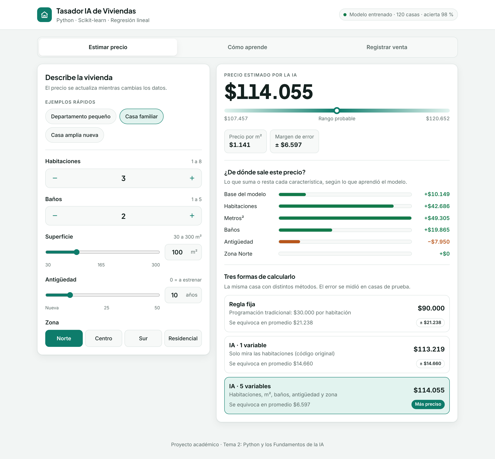

# 🏠 Tasador IA de Viviendas (Python + Scikit-learn)

**Tema 2: Python y los Fundamentos de la Inteligencia Artificial**

Aplicación web que estima el precio de una casa con Machine Learning. Parte del ejercicio
original (`modelo_simple.py`: habitaciones → precio) y lo lleva a un caso más real.



## Cómo ejecutarlo
```bash
cd prediccion-casas
pip install -r requirements.txt
python app.py
```
Abre http://localhost:5000 — en Windows también puedes hacer doble clic en `ejecutar.bat`.

Versión de consola original: `python modelo_simple.py`

## Qué demuestra
| Concepto | Dónde se ve en la app |
|---|---|
| **Programación tradicional** (regla fija `precio = 30000 × habitaciones`) vs **IA** (aprende de los datos con `modelo.fit`) | Tarjetas de comparación y tabla de precisión |
| Regresión lineal con **1 variable** (tu código) vs **5 variables** (habitaciones, m², baños, antigüedad, zona) | Los 3 precios del resultado |
| **Entrenamiento y prueba** (`train_test_split` 80/20) | Tabla "¿Qué tan bien acierta cada enfoque?" (error promedio y R²) |
| **Qué aprendió el modelo** (`coef_`, `intercept_`) | "Cada habitación suma $…", desglose del precio y gráfico |
| Variables de texto → números (`OneHotEncoder` para la zona) | `Pipeline` en `app.py` |
| **Aprender de datos nuevos** | Formulario "Registrar una venta real y reentrenar" |

## Resultados (datos de prueba)
| Enfoque | Error promedio | R² |
|---|---|---|
| Regla fija tradicional | ~$21 000 | 0.79 |
| IA con 1 variable | ~$15 000 | 0.91 |
| IA con 5 variables | ~$7 000 | 0.98 |

## Diseño UX/UI
Decisiones de diseño y el problema que resuelve cada una:

| Problema detectado | Solución |
|---|---|
| Todo estaba en una sola página larga | 3 pestañas según lo que quiere hacer el usuario: **Estimar precio**, **Cómo aprende** y **Registrar venta** |
| En el celular no se veía el precio mientras se movían los controles | **Barra fija abajo** con el precio siempre visible y botón "Ver detalle" |
| Los sliders eran imprecisos para valores pequeños (1 a 8) | **Botones − / +** para habitaciones y baños, y slider con campo numérico para m² y antigüedad |
| La zona en un desplegable escondía las opciones | **Botones segmentados**: se ven las 4 zonas de un vistazo |
| El usuario empezaba sin saber qué probar | **Ejemplos rápidos**: departamento pequeño, casa familiar, casa amplia nueva |
| Términos técnicos (R², MAE) | Lenguaje claro: "acierta 98 %", "se equivoca en promedio $6.597" |
| El rango de precio era solo texto | **Barra de rango** visual, precio por m² y margen de error |
| No se veía el efecto de reentrenar | Mensaje de **antes y después** del precio y la venta nueva resaltada en la tabla |
| Errores del formulario poco claros | Validación en línea campo por campo y avisos (toast) |

Accesibilidad: botones de 44 px o más para el dedo, navegación con teclado (flechas en pestañas y zonas),
foco visible, `aria-live` en el precio para lectores de pantalla, modo oscuro automático y respeto a
"reducir movimiento".

## Vista previa sin Python
`python exportar_vista_previa.py` genera `vista_previa.html`: la misma interfaz con el modelo ya
entrenado guardado dentro, para abrirla en el celular o compartirla. No permite reentrenar.

## Archivos
- `app.py` – servidor Flask + modelos de Scikit-learn
- `templates/index.html` – interfaz web (una sola plantilla para la app y la vista previa)
- `exportar_vista_previa.py` – genera la versión sin servidor
- `datos/casas.csv` – 120 ventas de ejemplo (creadas con `generar_datos.py`, que simula un mercado con ruido; el modelo no conoce esa fórmula y la descubre)
- `modelo_simple.py` – el ejercicio original de consola
- `static/chart.umd.min.js` – Chart.js incluido localmente (funciona sin internet)
